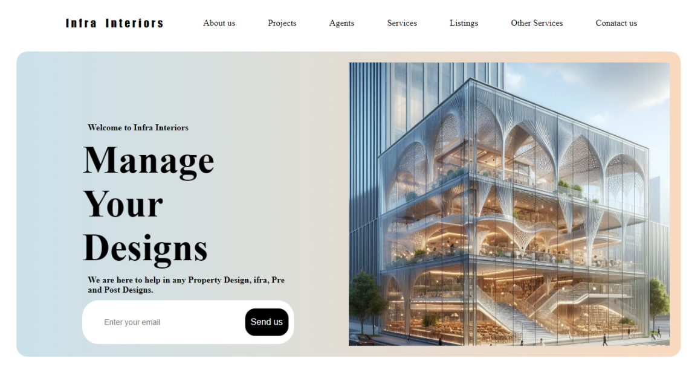

<div align="center">

# 🛋️ Infra Interiors – Interior Design Website

A beginner-friendly, open-source **interior design landing page** built with plain **HTML** and **CSS**.
No frameworks. No build tools. Just open the file and start learning.

[](LICENSE)
[](https://github.com/arshc0der/Interior_Design_Website/commits/main)
[](https://github.com/arshc0der/Interior_Design_Website/issues)
[](CONTRIBUTING.md)
[](https://github.com/arshc0der/Interior_Design_Website/labels/good%20first%20issue)
[](https://github.com/arshc0der/Interior_Design_Website/stargazers)



[Contribute](CONTRIBUTING.md) · [Report a bug](https://github.com/arshc0der/Interior_Design_Website/issues/new/choose) · [Browse issues](https://github.com/arshc0der/Interior_Design_Website/issues) · [Full preview](preview/infra.png)

</div>

---

## 📖 Table of contents

- [About](#-about)
- [Current status](#-current-status)
- [Tech stack](#-tech-stack)
- [Getting started](#-getting-started)
- [Project structure](#-project-structure)
- [Customizing the site](#-customizing-the-site)
- [How to contribute](#-how-to-contribute)
- [Documentation index](#-documentation-index)
- [License](#-license)
- [Contact](#-contact)

## 🏠 About

**Infra Interiors** is a single-page website template for an interior design company. It shows a hero section, a three-step "how it works" block, recent projects, services, office locations, a blog preview, a newsletter box and a footer.

It is a great **first open-source project**: the code is small (one HTML file and one CSS file), easy to read, and there are plenty of clearly described issues to pick from.

## 🚦 Current status

This project is in **Beta**. Being honest about what exists today helps new contributors know where to help:

| Area | Status |
| --- | --- |
| Single-page layout (HTML + CSS) | ✅ Done |
| Hero, projects, services, blog, newsletter, footer sections | ✅ Done |
| Mobile / tablet responsive layout | 🚧 Not yet – needs `@media` queries |
| JavaScript interactivity (menu, forms, gallery) | 🚧 Not yet – no JS file exists |
| Accessibility (alt text, landmarks, focus styles) | 🚧 Needs work |
| SEO (meta tags, favicon, Open Graph) | 🚧 Needs work |
| Extra pages (About, Projects, Contact, 404) | 🚧 Not yet |

The full list of known problems and ideas is in [`docs/ISSUES_BACKLOG.md`](docs/ISSUES_BACKLOG.md) (60 items, many marked **good first issue**).

## 🔧 Tech stack

- **HTML5** – page structure (`index.html`)
- **CSS3** – styling and layout using Flexbox (`style.css`)
- **JavaScript** – planned, see the issue list

## 🚀 Getting started

You only need a web browser and (optionally) a code editor such as [VS Code](https://code.visualstudio.com/).

```bash
# 1. Clone the project
git clone https://github.com/arshc0der/Interior_Design_Website.git

# 2. Go into the folder
cd Interior_Design_Website

# 3. Open index.html in your browser (double-click it), or run a local server:
python3 -m http.server 8000
# then visit http://localhost:8000
```

> 💡 Tip: In VS Code, install the **Live Server** extension, right-click `index.html` and choose **Open with Live Server**. The page reloads every time you save.

Want to contribute? Please fork the repository first. The step-by-step guide is in [CONTRIBUTING.md](CONTRIBUTING.md).

## 🗂️ Project structure

```text
Interior_Design_Website/
├── index.html          # The whole page (all sections)
├── style.css           # All styles
├── images/             # Photos and backgrounds
├── icons/              # Small PNG icons
├── preview/            # Screenshots used in this README
├── docs/               # Guides for contributors
│   ├── ISSUES_BACKLOG.md
│   ├── PROJECT_STRUCTURE.md
│   ├── STYLE_GUIDE.md
│   └── GIT_CHEAT_SHEET.md
├── .github/            # Issue templates, PR template, code owners
├── CONTRIBUTING.md     # Start here to contribute
├── CODE_OF_CONDUCT.md
├── SECURITY.md
├── CHANGELOG.md
└── LICENSE
```

A deeper explanation of each section of the page is in [`docs/PROJECT_STRUCTURE.md`](docs/PROJECT_STRUCTURE.md).

## 🎨 Customizing the site

1. **Images** – replace files in `images/`. Keep the same file names or update the paths in `index.html` and `style.css`. Compress images first (for example with [Squoosh](https://squoosh.app/)).
2. **Colors and fonts** – edit `style.css`. The main colors are the gradient `#cae1ea → #f9d9be` and black.
3. **Text** – edit the content inside `index.html`.

## 🤝 How to contribute

Everyone is welcome, including people who have never used Git before.

1. Pick an issue from the [issues page](https://github.com/arshc0der/Interior_Design_Website/issues) (look for **good first issue**) and comment that you would like to work on it.
2. Follow the beginner guide: **[CONTRIBUTING.md](CONTRIBUTING.md)** (fork → clone → branch → change → commit → push → pull request).
3. Open a pull request and wait for a review.

## 📚 Documentation index

| File | What it is for |
| --- | --- |
| [CONTRIBUTING.md](CONTRIBUTING.md) | Step-by-step guide to make your first contribution |
| [docs/GIT_CHEAT_SHEET.md](docs/GIT_CHEAT_SHEET.md) | Git commands explained in plain words |
| [docs/STYLE_GUIDE.md](docs/STYLE_GUIDE.md) | How we write HTML, CSS and commit messages |
| [docs/PROJECT_STRUCTURE.md](docs/PROJECT_STRUCTURE.md) | What each file and section does |
| [docs/ISSUES_BACKLOG.md](docs/ISSUES_BACKLOG.md) | Known problems and ideas |
| [CODE_OF_CONDUCT.md](CODE_OF_CONDUCT.md) | How we treat each other |
| [SECURITY.md](SECURITY.md) | How to report a security problem |
| [CHANGELOG.md](CHANGELOG.md) | History of changes |

## 📝 License

Released under the [MIT License](LICENSE). You are free to use, copy and modify this project.

## 📞 Contact

Maintainer: [@arshc0der](https://github.com/arshc0der)

If this project helps you learn, please give it a ⭐ – it helps others find it.
